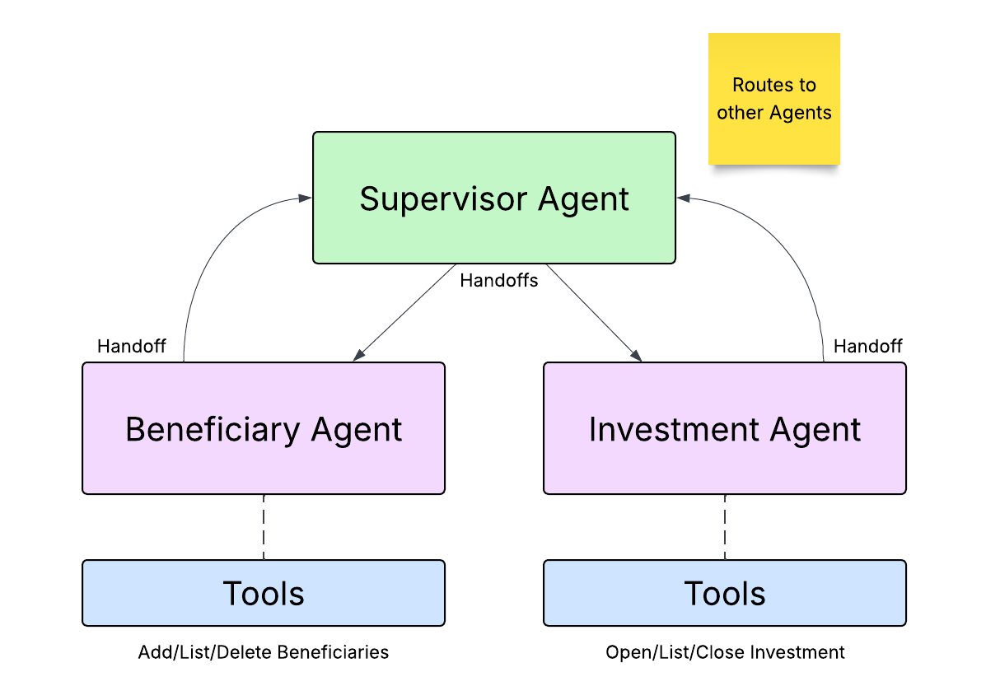

# Wealth Management Agent Example using OpenAI Agents SDK
Demonstrates how to use [OpenAI Agents SDK](https://openai.github.io/openai-agents-python/) using handoffs to other agents. 
Shows an example of just using OpenAI Agents SDK and another version that leverages [Temporal](https://temporal.io) to 
wrap the agentic flow with Temporal.



The vanilla OpenAI Agents SDK version of this example is located [here](src/oai_supervisor/README.md).
The Temporal version of this example is located [here](src/temporal_supervisor/README.md).

Scenarios currently implemented include
* Add Beneficiary - add a new beneficiary to your account
* List Beneficiaries - shows a list of beneficiaries and their relationship to the account owner
* Delete Beneficiary - delete a beneficiary from your account
* Open Investment Account - opens a new investment account
  * In the Temporal version this uses a **child workflow** with KYC confirmation, a compliance review, and a saga that rolls back on failure.
    There are Python and Java versions of this workflow. By default, the Python version is used.
  * The OpenAI Agents SDK (non-Temporal) version opens the account directly with a simple tool (no KYC, compliance review or saga).
* List Investments - shows a list of accounts and their current balances
* Close Investment Account - closes an investment account
* Off-topic questions - questions that aren't about beneficiaries or investment accounts are politely declined by the supervisor agent (handled in the agents' prompts)

You can run through the scenarios with the Temporal version using a [Web Application](src/frontend/README.md).
The OpenAI Agents SDK version runs as a command-line chat.

The demo data lives in the `data/` folder (`beneficiaries.json`, `clients.json`, `funding_accounts.json`, `investments.json`),
which is tracked by git. Adding or deleting beneficiaries, opening or closing accounts, and updating client details during KYC change these files.
To reset the demo data:

```bash
git checkout data/
```

## Prerequisites

* [uv](https://docs.astral.sh/uv/) - Python Dependency Management. The project requires Python 3.13 (`requires-python = ">=3.13,<3.14"`); `uv sync` installs it if needed.
* [OpenAI API Key](https://platform.openai.com/api-keys) - Your key to accessing OpenAI's LLM
* [Temporal CLI](https://docs.temporal.io/cli#install) - Local Temporal service (Temporal version)
* [Redis](https://redis.io/downloads/) - Stores conversation history, real-time status updates and the chaos panel's flags (Temporal version)
* [Node.js](https://nodejs.org/en/download) 18 or later, with npm - Runs the web application (Temporal version)
* [Java JDK 25](https://adoptium.net/) - Optional. Only needed for the Java version of the Open Investment Account workflow. The Gradle wrapper is included, so no separate Gradle install is needed. See [java/README.md](java/README.md).

## Set up Python Environment
```bash
uv sync
```

## Set up your OpenAI API Key
 
```bash
cp setoaikey.example setoaikey.sh
chmod +x setoaikey.sh
```

Now edit the setoaikey.sh file and paste in your OpenAI API Key.
It should look something like this:
```text
export OPENAI_API_KEY=sk-proj-....
```

## Getting Started

* The OpenAI Agents SDK version of this example is located [here](src/oai_supervisor/README.md).
* The Temporal version of this example is located [here](src/temporal_supervisor/README.md).
