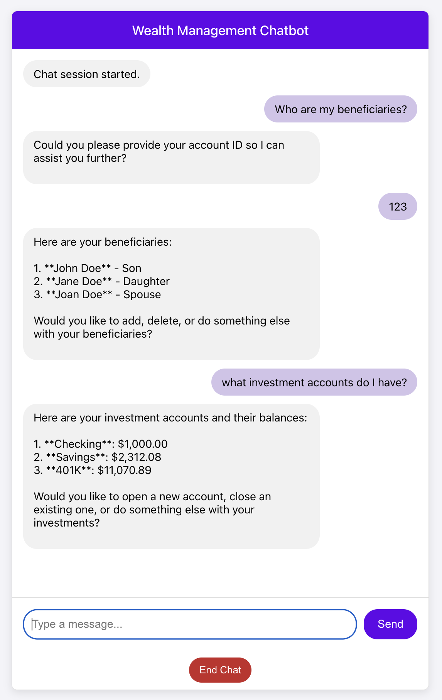

# React Web App for Wealth Management

An easy to use web based front end for the Wealth Management Agent. 
It uses the [API](../api/README.md) to interact with Temporal.

## Prerequisites 

[Node.js](https://nodejs.org/en/download): Version 18 or higher, with npm.

The web application relies on the API to communicate with Temporal. 
Be sure to follow the instructions to run the API, which can be found [here](../api/README.md)

Note that the web application communicates directly with the API and the API is what 
communicates with Temporal running locally or in the cloud.

The API URL is set in [`src/config.js`](src/config.js) (`API_BASE_URL`, default `http://127.0.0.1:8000`).
The API's CORS settings allow the web application on port 3000 (`http://localhost:3000` and
`http://127.0.0.1:3000`), so run it on that port.

## Install Dependencies
From the repository root:
```bash
cd src/frontend
npm install
```

## Running the Web App
```bash
cd src/frontend
npm start
```

A browser window opens at http://localhost:3000. Click **Start Chat** to start a conversation. Each
chat starts a new chat workflow with a random ID (`oai-temporal-agent-<random>`); **End Chat** ends it.

Click **Chaos** in the chat header to open the chaos panel, which turns failure scenarios on and off
at runtime and lists the failures as they happen. See
[Failure scenarios](../temporal_supervisor/README.md#failure-scenarios-chaos-panel).

Remember, if you are opening a new investment account, in another terminal
send the compliance approval to the Open Account child workflow. See
[How to find the Child Workflow ID](../temporal_supervisor/README.md#send-the-compliance-reviewed-signal).

### Send the Compliance Reviewed Signal (Local)
```bash
cd src/temporal_supervisor
./localsendcomplianceapproval.sh <Child Workflow ID>
```

or
### Send the Compliance Reviewed Signal (Cloud)
```bash
cd src/temporal_supervisor
./cloudsendcomplianceapproval.sh <Child Workflow ID>
```

## Tests
```bash
cd src/frontend
npm test
```

`npm test` starts Jest in watch mode; press `q` to quit (or run `CI=true npm test` to run once).

## Example

Here's an example screenshot of the web application running:


