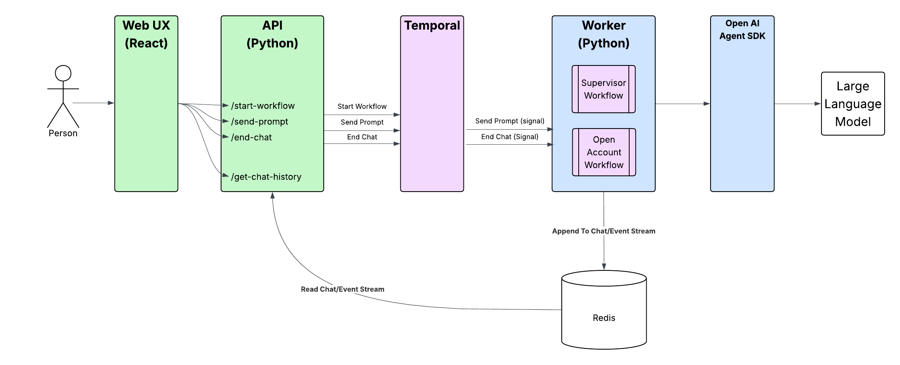
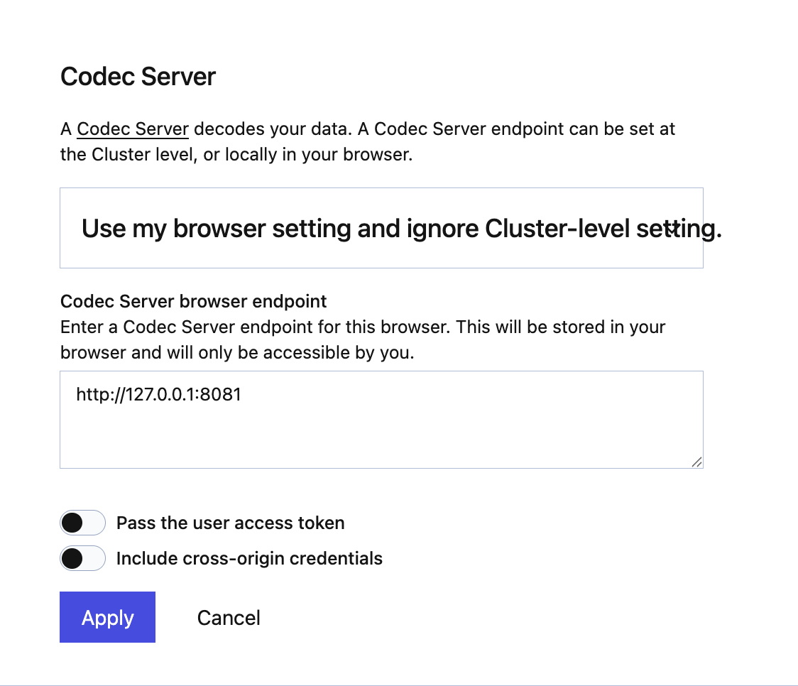
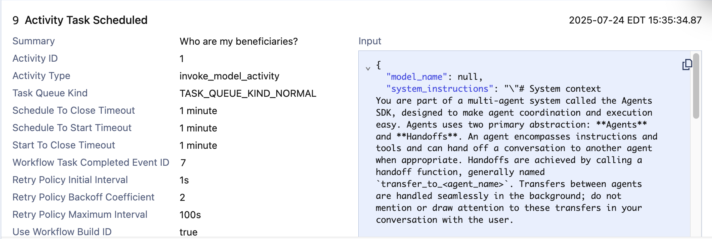
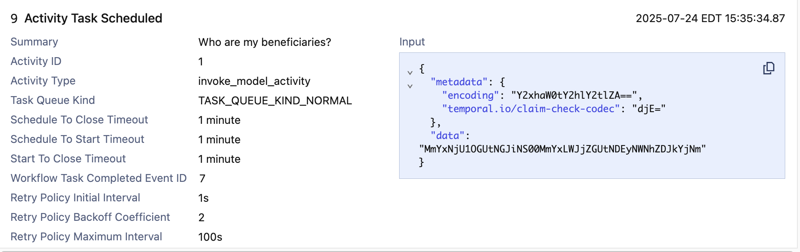
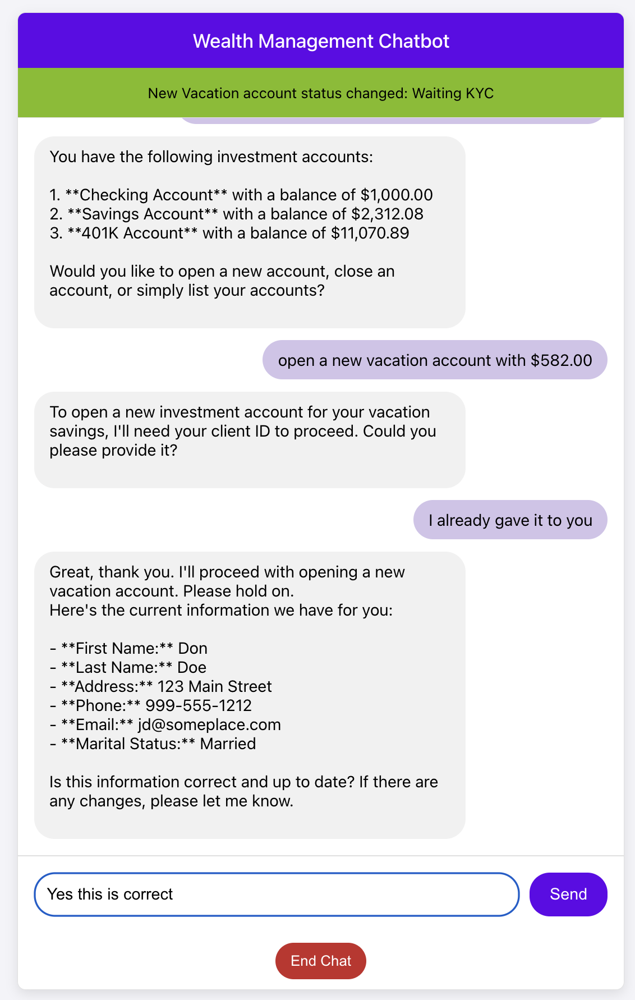
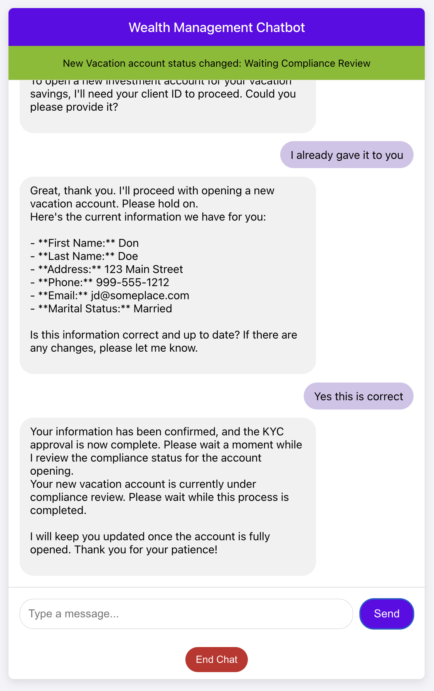
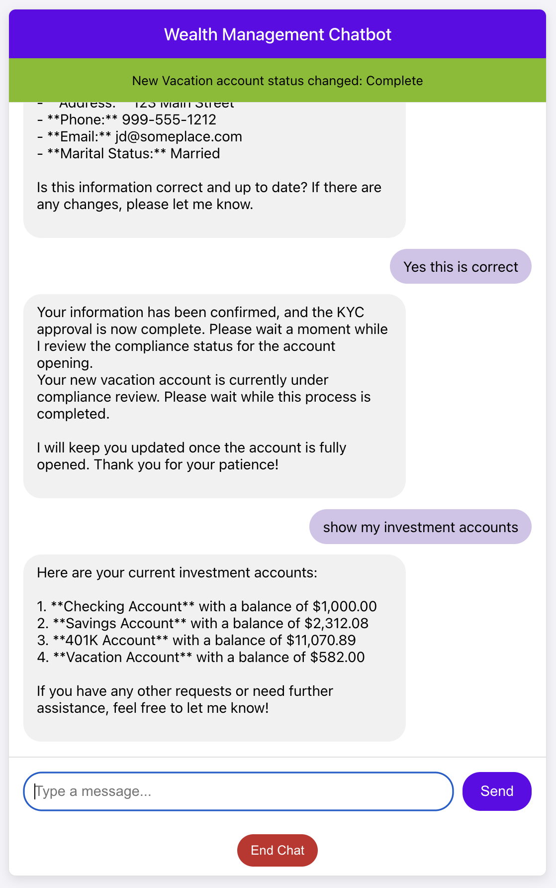
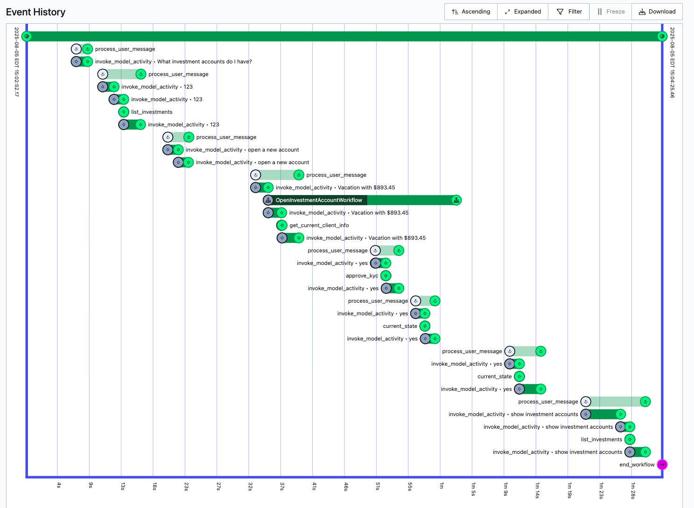
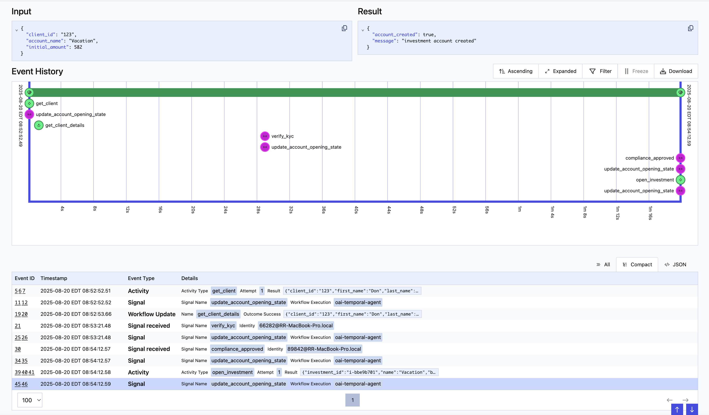

# Wealth Management Agent Example using OpenAI Agents SDK
Demonstrates how to use OpenAI Agents with Temporal. It demonstrates how to use handoffs to other agents. 
The supervisor agent is responsible for directing the actions to the appropriate helper agents.   

Scenarios currently implemented include
* Add Beneficiary - add a new beneficiary to your account
* List Beneficiaries - shows a list of beneficiaries and their relationship to the account owner
* Delete Beneficiary - delete a beneficiary from your account
* Open Investment Account - opens a new investment account using a **Child Workflow**
  * There are Python and Java versions of this workflow. By default, the Python version is used.
* List Investments - shows a list of accounts and their current balances
* Close Investment Account - closes an investment account
* Off-topic questions - questions that aren't about beneficiaries or investment accounts are politely declined by the supervisor agent (handled in the agents' prompts)

These scenarios change the demo data in the `data/` folder at the repository root (`beneficiaries.json`,
`clients.json`, `funding_accounts.json`, `investments.json`). To reset it, from the repository root:

```bash
git checkout data/
```

## Application Architecture

The overall application architecture looks like this:



There is a React UX which is where the customer interacts with the application. 
The React UX leverages an [API](../api/README.md) which exposes endpoints to start a workflow, send a prompt,
retrieve the chat history, end the chat, and control the chaos panel. The React frontend uses adaptive polling
to retrieve new events from Redis (through the API), providing real-time status updates as the Open Account 
child workflow progresses through the different steps. 

The API in turn, communicates with Temporal to start workflows and send signals. Finally, 
the worker contains the two workflows - supervisor and open account - which contain the 
agents and business logic that drive the agentic application. The model (LLM) calls run as
activities on their own task queue so they can be rate limited separately (see
[Failure scenarios](#failure-scenarios-chaos-panel)).

The chat workflow keeps the whole conversation in one workflow run. A production system would
use continue-as-new for long conversations (see the TODO in `workflows/supervisor_workflow.py`).


## Prerequisites

* [uv](https://docs.astral.sh/uv/) - Python Dependency Management. The project requires Python 3.13; `uv sync` installs it if needed.
* [OpenAI API Key](https://platform.openai.com/api-keys) - Your key to accessing OpenAI's LLM
* [Temporal CLI](https://docs.temporal.io/cli#install) - Local Temporal service
* [Redis](https://redis.io/downloads/) - Redis - Required to store the conversation history, status updates and chaos panel flags, and optional for the Claim Check pattern.
* [Node.js](https://nodejs.org/en/download) 18 or later, with npm - Runs the React UX.
* [Java JDK 25](https://adoptium.net/) - Java - Optional. Only needed if you want to run the Java Open Investment Account workflow. The Gradle wrapper is included, so no separate Gradle install is needed. See [java/README.md](../../java/README.md).

## Set up Python Environment
From the repository root:
```bash
uv sync
```

## Set up your OpenAI API Key

From the repository root (the worker scripts source `../../setoaikey.sh`, so it must be in the repository root):
```bash
cp setoaikey.example setoaikey.sh
chmod +x setoaikey.sh
```

Now edit the setoaikey.sh file and paste in your OpenAI API Key.
It should look something like this:
```bash
export OPENAI_API_KEY=sk-proj-....
```
## Set up Redis

Redis is used for storing conversation history and providing real-time status updates. If you don't have an existing Redis server, you can run one locally after installing it. 

In a new terminal / shell run the following command:

```bash
redis-server
```

By default, the application expects to find Redis running locally. You can override the location of Redis
for the Python components (worker, API, codec server) by setting the environment variables:

```bash
export REDIS_HOST=localhost
export REDIS_PORT=6379
```

The optional Java worker reads its Redis location (only used for Claim Check) from `spring.data.redis`
in `java/src/main/resources/application.yaml` when run locally; see [java/README.md](../../java/README.md).

## Set up Claim Check (optional)

An optional configuration is to substitute the data sent to Temporal (e.g. function/method parameters and return values)
with an ID. This is known as the [Claim Check Pattern](https://www.enterpriseintegrationpatterns.com/patterns/messaging/StoreInLibrary.html). 
The original data is stored in Redis. This uses a 
[Custom Payload Codec](https://docs.temporal.io/develop/python/converters-and-encryption#custom-payload-codec) 
that intercepts data going to Temporal Cloud, replaces it with a GUID. When the data is retrieved, it looks up the GUID 
replaces it with the data stored in Redis.

From the repository root:
```bash
cp setclaimcheck.example setclaimcheck.sh
chmod +x setclaimcheck.sh
```

Claim Check is optional. The start scripts (worker, API, codec server, compliance approval) source
`setclaimcheck.sh` if it exists; if you haven't created it, they run without Claim Check.

Now edit the setclaimcheck.sh file and fill in the location of Redis
It should look something like this:
```bash
export USE_CLAIM_CHECK=true
export REDIS_HOST=localhost
export REDIS_PORT=6379
```

Save the file and be sure that you have Redis running. For example:

```bash
redis-server
```

Note that the application assumes you only have one Redis server that is used by the application for storing the 
conversation history and is also used if Claim Check has been enabled. 

Be aware that using a claim check pattern introduces performance costs by doing remote calls to Redis for every payload. 
Also, make sure your Redis implementation is rock solid as any downtime will directly affect your workflows. 

## Run Codec Server for Claim Check (optional)
If you have decided to set up the Claim Check above, you will 
most likely want to also run a Codec Server to be able to see the actual sent to 
the workflow and activities. 

Be sure you have updated the setclaimcheck.sh as mentioned above.

To run the Codec Server:
```bash
cd src/temporal_supervisor
./startcodecserver.sh
```

And of course, make sure that your Redis Server is up and running. 

Once it's up and running, the default endpoint is http://127.0.0.1:8081.

Open up your browser and navigate to the Temporal UI. Locally, open it at exactly http://localhost:8233
(not 127.0.0.1): the codec server only accepts requests (CORS) from http://localhost:8233 and https://cloud.temporal.io.
For Temporal Cloud that will be https://cloud.temporal.io

In the upper right, there is an icon that looks like glasses. Click on that and you 
can configure your codec server. 

Change the drop down to "Use my browser setting and ignore Cluster-level setting".

Use the endpoint of your codec server (default is http://127.0.0.1:8081). Be sure there are no 
extra spaces at the end of the URL or it will not work. You can turn off the two options - Pass the 
user access token and Include cross-origin credentials. Click on apply and you have configured 
the codec server. 



As you run through different scenarios, you'll be able to see the decoded values in the browser.



If you remove the codec server settings, you won't be able to see anything other than a BASE64 Encoded ID.



## Running the Demo Locally
Start Temporal Locally.

```bash
temporal server start-dev
```

Start Redis (see [Set up Redis](#set-up-redis)) in another terminal:

```bash
redis-server
```

All of the commands below start from the repository root, each in its own terminal.

### Start the Worker using Python Open Investment Account Workflow (default)

```bash
cd src/temporal_supervisor
./startlocalworker.sh
```

The worker also runs the model (LLM) activities on a second task queue (`Supervisor-llm` by default).
See [Environment variables](#environment-variables) to change the task queues or rate limit the model calls.

If you want to use the Java Open Investment Account Workflow, 
you need to specify the name of the Task Queue when running the Python worker
(`setsplitworkflows.sh` sets `TEMPORAL_TASK_QUEUE_OPEN_ACCOUNT` from it, and the Python worker then
doesn't register the Python Open Account workflow):

```bash
cd src/temporal_supervisor
./startlocalworker.sh Open-Account-Java
```
and then start the Java worker, making sure you pass in the same name as you did 
when you started the Python worker

```bash
cd java
./startlocalworker.sh Open-Account-Java
```

See [java/README.md](../../java/README.md) for details.

### Start the API

```bash
cd src/api
./startlocalapi.sh
```
### Start the UX

The first time, install the dependencies:
```bash
cd src/frontend
npm install
```

Then start it:
```bash
cd src/frontend
npm start
```

A new browser window opens where you can interact with the application. Click **Start Chat**; each
chat gets its own workflow ID (`oai-temporal-agent-<random>`).

If you are opening a new investment account, in another terminal
### Send the Compliance Reviewed Signal 
```bash
cd src/temporal_supervisor
./localsendcomplianceapproval.sh <Child Workflow ID>
```

The Child Workflow ID has the format `OpenAccount-<chat workflow ID>-<client ID>-<account name>-<n>`,
where `<n>` numbers the account openings started in that chat (1, 2, 3, ...), for example
`OpenAccount-oai-temporal-agent-k3j9x2m1q8-123-Vacation-1`. Every request to open an account starts a
new account opening with its own KYC, even for an account name that was opened, or is still being
opened, earlier in the chat, so a chat can have several openings of "Vacation" waiting at once. The
chat doesn't show the ID. To find it, open the Temporal UI (http://localhost:8233 locally) and look for
the running `OpenInvestmentAccountWorkflow` (a child of your chat workflow), or list the running ones
(the newest first) with:

```bash
temporal workflow list --query "WorkflowType='OpenInvestmentAccountWorkflow' AND ExecutionStatus='Running'"
```

Quote the ID if the account name contains spaces. You can also send the signal with the Temporal CLI
(locally, without Claim Check):

```bash
temporal workflow signal --workflow-id "<Child Workflow ID>" --name compliance_approved
```

## Running the Demo in Temporal Cloud

Copy the setcloudenv.example, located in the src/temporal_supervisor folder to the project root and name it setcloudenv.sh .
The cloud scripts source it from there (`../../setcloudenv.sh`).

From the repository root:
```bash
cp src/temporal_supervisor/setcloudenv.example setcloudenv.sh
```

Edit setcloudenv.sh to match your Temporal Cloud account:
```bash
export TEMPORAL_ADDRESS=<namespace>.<accountID>.tmprl.cloud:7233
export TEMPORAL_NAMESPACE=<namespace>.<accountID>
export TEMPORAL_TLS_CLIENT_CERT_PATH="/path/to/cert.pem"
export TEMPORAL_TLS_CLIENT_KEY_PATH="/path/to/key.key"
```

### Start the Worker
```bash
cd src/temporal_supervisor
./startcloudworker.sh
```

If you want to use the Java Open Investment Account Workflow, 
you need to specify the name of the Task Queue when running the Python worker:

```bash
cd src/temporal_supervisor
./startcloudworker.sh Open-Account-Java
```
and then start the Java worker, making sure you pass in the same name as you did 
when you started the Python worker

```bash
cd java
./startcloudworker.sh Open-Account-Java
```

The Java cloud worker needs the client key in PKCS8 format; the script prints the `openssl`
command to convert it if needed. See [java/README.md](../../java/README.md#running-with-temporal-cloud).

### Start the API

```bash
cd src/api
./startcloudapi.sh
```
### Start the UX

```bash
cd src/frontend
npm install   # first time only
npm start
```

If you are opening a new investment account, in another terminal
### Send the Compliance Reviewed Signal 
```bash
cd src/temporal_supervisor
./cloudsendcomplianceapproval.sh <Child Workflow ID>
```

Find the Child Workflow ID in the Temporal Cloud UI (https://cloud.temporal.io) as described
[above](#send-the-compliance-reviewed-signal).

Here are a few screenshots of the UX while opening a new account.

Waiting for KYC to be confirmed:


Waiting for the Compliance Review to be done:


New account is complete and opened:


You can also add and delete beneficiaries.

Here is a sample event history shown in the Temporal UX



And here is a sample event history for the Open Account workflow in the Temporal UX:



## How the Open Account functionality works
To demonstrate how to integrate other workflows within an Agentic system, when a user
wants to open a new investment account, a child workflow (`OpenInvestmentAccountWorkflow`) is created.
The Investment Agent hands off to a special Open Account Agent, which is designed specifically to
create and interact with the `OpenInvestmentAccountWorkflow`.

1. **Start.** The `open_new_investment_account` tool (a `@function_tool` in `activities/open_account.py`)
   runs in the context of the chat workflow. It first checks the business rules with the
   `validate_new_account` activity (initial deposit between $100 and $1,000,000; a violation is
   returned to the agent, which explains it), looks up any promotion with `find_promotion`, and then
   starts the child workflow with `workflow.start_child_workflow()` on the Open Account task queue.
   The child workflow ID is `OpenAccount-<chat workflow ID>-<client ID>-<account name>-<n>`, where `<n>`
   is the number of account openings started in the chat, counting this one. The count is kept in the
   chat workflow's state, so it is deterministic and survives replay, and it only goes up when a child
   is actually started. Every request to open an account starts a new opening, with its own KYC, even
   if an account with the same name was opened, or is still being opened, earlier in the chat. The
   tool returns the ID, and the agent passes it to the other tools.
2. **Status.** The child workflow signals every state change to the parent
   (`update_account_opening_state`). The chat workflow records it and streams it to the UX as a
   status update. The agent reads the latest state with the `get_account_opening_status` tool
   instead of relying on the conversation history.
3. **KYC.** While the child is in `Waiting KYC`, the agent calls `get_current_client_info` (an
   activity that executes the child's `get_client_details` update) and shows the customer their
   details. If the customer confirms them in a later message, the agent calls `approve_kyc` (the
   `verify_kyc` signal). If something has changed, the agent calls `update_client_details` (an update
   that saves the changes and completes KYC). `approve_kyc` refuses to approve until this account
   opening's details have been shown and the customer has replied since, so a confirmation for an
   earlier opening can't approve a new one.
4. **Compliance.** The child then waits in `Waiting Compliance Review` for the `compliance_approved`
   signal, which a compliance officer sends outside the chat with `localsendcomplianceapproval.sh` /
   `cloudsendcomplianceapproval.sh` (see [Send the Compliance Reviewed Signal](#send-the-compliance-reviewed-signal)).
5. **Saga.** After compliance approval, the child workflow opens the account as a saga: it creates
   the account record (`open_investment`), transfers the initial deposit from the client's linked bank
   account (`debit_linked_account`, `data/funding_accounts.json`), and registers the account with the
   custodian (`register_account`). If a step fails with a non-retryable error, the completed steps are
   undone in reverse order (`credit_linked_account`, then `remove_investment`) and the state becomes
   `Rolled back. ...`. On success the state becomes `Complete`, and the Open Account Agent hands back
   to the Investment Agent.

If the chaos panel's **Bug in workflow code** switch is on, `find_promotion` returns the
`WELCOME-BONUS` promo code, and the workflow pauses after compliance approval on a bug in its
welcome-bonus code. See [Bug in the workflow code](#bug-in-the-workflow-code).

One important thing to remember is to be sure you don't ask the agent to repeatedly 
poll the workflow as it will most likely result in a Max Turns exceeded exception. It is 
possible to change the value of Max Turns as a parameter to `Runner.run`, just be very careful. 

### Testing the Open Account workflow on its own

`startlocalopenaccount.sh` starts a local worker without the OpenAI Agents plugin
(`SKIP_OPENAI_PLUGIN=True`, so no OpenAI key is needed) in the background, runs
`run_open_account_workflow.py`, which starts `OpenInvestmentAccountWorkflow` directly (no chat, no LLM)
for three scenarios: KYC approved, client details updated, and a third that waits for you to send the
compliance approval yourself. It stops the worker when the scenarios finish. Temporal and Redis must
be running. The script can be run from any directory:

```bash
src/temporal_supervisor/startlocalopenaccount.sh
```

With a task queue name, the workflow runs on that queue (`TEMPORAL_TASK_QUEUE_OPEN_ACCOUNT`), so you
can run the same scenarios against the Java workflow (start `java/startlocalworker.sh <queue>` first):

```bash
src/temporal_supervisor/startlocalopenaccount.sh Open-Account-Java
```

When the output asks you to signal the third workflow, in another terminal run:

```bash
cd src/temporal_supervisor
./localsendcomplianceapproval.sh testing-open-investment-account-workflow3
```

## Environment variables

The start scripts set most of these for you. The Python components read them through
`common/client_helper.py`, `common/redis_config.py` and the Temporal environment configuration.

| Variable | Default | Used for |
|---|---|---|
| `OPENAI_API_KEY` | none | OpenAI API key (`setoaikey.sh`) |
| `TEMPORAL_ADDRESS` | `127.0.0.1:7233` | Temporal service address (`setcloudenv.sh` for Temporal Cloud) |
| `TEMPORAL_NAMESPACE` | `default` | Temporal namespace |
| `TEMPORAL_TLS_CLIENT_CERT_PATH`, `TEMPORAL_TLS_CLIENT_KEY_PATH` | none | mTLS client certificate and key for Temporal Cloud |
| `TEMPORAL_TASK_QUEUE` | `Supervisor` | Task queue of the chat workflow and the tool activities. The worker, the API and the Java worker must use the same value. |
| `TEMPORAL_TASK_QUEUE_OPEN_ACCOUNT` | value of `TEMPORAL_TASK_QUEUE` | Task queue of the Open Account child workflow. Set by the first argument to `startlocalworker.sh` / `startcloudworker.sh` (through `setsplitworkflows.sh`) and `startlocalopenaccount.sh`. |
| `TEMPORAL_TASK_QUEUE_LLM` | `<TEMPORAL_TASK_QUEUE>-llm` | Task queue of the model (LLM) activities |
| `LLM_MAX_CALLS_PER_SECOND` | unlimited | Rate limit for model calls across all workers, e.g. `LLM_MAX_CALLS_PER_SECOND=0.2 ./startlocalworker.sh` |
| `REDIS_HOST`, `REDIS_PORT` | `localhost`, `6379` | Redis for conversation history, status updates, chaos flags and Claim Check (Python components) |
| `USE_CLAIM_CHECK` | `false` | Enables the Claim Check codec (`setclaimcheck.sh`) |
| `SKIP_OPENAI_PLUGIN` | `False` | Runs the worker without the OpenAI Agents plugin (set by `startlocalopenaccount.sh`) |

## Failure scenarios (chaos panel)

Click **Chaos** in the chat header to open the chaos panel. Its switches inject
failures at runtime: activities and the model read the flags from Redis on every
attempt, so you can turn a failure on and off mid-conversation without restarting
anything. The panel also lists each injected failure as it happens (activity and
attempt number). Open the [Temporal UI](http://localhost:8233) alongside it to show
the pending activity, its attempt count, and the last failure. **Reset all** turns
every flag off.

| Scenario | How to show it | What Temporal does |
|---|---|---|
| **Tool / API down** | Turn on *Core banking API down*, then ask to list your investments (or open an account, so it fails after compliance approval). Turn it off. | The activity retries (1s backoff, capped at 5s) for as long as the outage lasts. The agent waits mid-turn and answers once the API is back. Nothing is lost or re-asked. |
| **LLM down** | Turn on *OpenAI API down* and send a message. Turn it off. | The model call is an activity, so it retries the same way (capped at 10s). The conversation picks up exactly where it was. |
| **LLM rate limited (reactive)** | Turn on *OpenAI rate limited (429)* and send a message. | The model raises an `ApplicationError` with `next_retry_delay` (15s, like a `Retry-After` header), which overrides the retry policy's backoff. Real OpenAI 429s are handled the same way: the `OpenAIAgentsPlugin` turns the response's `Retry-After` header into the next retry delay. The OpenAI client's own retries are turned off (`max_retries=0`) so Temporal decides. |
| **LLM rate limited (proactive)** | Start the worker with `LLM_MAX_CALLS_PER_SECOND` set (`cd src/temporal_supervisor && LLM_MAX_CALLS_PER_SECOND=0.2 ./startlocalworker.sh`), then chat in several browser tabs at once. | Model calls run on their own task queue (`<TEMPORAL_TASK_QUEUE>-llm`, or `TEMPORAL_TASK_QUEUE_LLM`). The Temporal service dispatches at most that many per second across *all* workers, so calls queue up instead of hitting the provider's limit. Tools on the main queue aren't slowed down. |
| **Business rule (non-retryable)** | Ask to open an account with $2,000,000 (or less than $100). | `validate_new_account` raises a non-retryable `ApplicationError`: one attempt, no retries. The reason goes back to the agent, which explains it to the customer. Compare it with *Tool / API down* in the Temporal UI. |
| **Saga** | Turn on *Custodian rejects new accounts* (and *Slow account-opening steps* so you can watch), then open an account through compliance approval. Without flags: as client `123`, open an account with $300,000 (the linked bank account has $250,000). | The completed steps are undone in reverse order (refund, then remove the account). Compensations are activities too, so they are retried until they succeed. Kill the worker mid-rollback and the rollback still finishes. Transfers are idempotent (keyed by the workflow and run ID), so a retried debit or refund never moves money twice. |
| **Bug in workflow code** | Turn on *Bug in workflow code*, then open an account through compliance approval. See below. | The workflow pauses at the failing line, keeping all its state, until a worker with fixed code picks it up. |

### Bug in the workflow code

While **Bug in workflow code** is on, `find_promotion` gives new account openings a
`WELCOME-BONUS` promo code, which is passed to `OpenInvestmentAccountWorkflow` as
part of its input. The welcome-bonus code path (`_welcome_bonus` in
`workflows/open_account_workflow.py`) has a real bug: it reads
`inputs.initial_deposit`, a field that doesn't exist. Openings without the promo
code never reach it.

Right after compliance approval, the workflow raises `AttributeError:
'OpenInvestmentAccountInput' object has no attribute 'initial_deposit'`. In the
Python SDK an ordinary exception fails the *workflow task*, not the workflow, so
the workflow stays **Running**, paused at that point with the compliance approval
intact. The Temporal UI shows the failing workflow task and its stack trace.
Other conversations, and openings without the promo code, keep working.

Turning the switch off doesn't help: the promo code is part of the workflow's
input, so every retry hits the same line. The fix is code. Change
`inputs.initial_deposit` to `inputs.initial_amount` and restart the worker. The
workflow resumes on the server's next workflow-task retry and opens the account
with the bonus. Workflow-task retries back off over time, up to 10 minutes; if the
fix is deployed within a couple of minutes, the workflow resumes within about a minute.

After the demo, re-arm the bug:

```bash
git checkout src/temporal_supervisor/workflows/open_account_workflow.py
```

### With the Java Open Account workflow

All the scenarios work the same way when the Java version of `OpenInvestmentAccountWorkflow`
is used (see [Running the Demo Locally](#running-the-demo-locally)). The Java workflow calls
the Python activities by name on the Python worker's task queue, so the chaos flags, which are
read inside those activities and the model activity, apply unchanged. The saga uses the
Temporal Java SDK's `Saga` class.

The bug in the workflow code is different in Java. `BONUS_RATES` in
`java/src/main/java/io/temporal/demo/wealthmanagement/workflow/OpenInvestmentAccountWorkflowImpl.java`
is keyed by `"WELCOME_BONUS"` (underscore), but the promo code is `"WELCOME-BONUS"` (hyphen),
so `welcomeBonus` throws a `NullPointerException`. As in Python, an unchecked exception fails
the workflow task, not the workflow, so it stays **Running**. The fix is the commented-out line
above it. Restart the Java worker after fixing it, and re-arm the bug afterwards with:

```bash
git checkout java/src/main/java/io/temporal/demo/wealthmanagement/workflow/OpenInvestmentAccountWorkflowImpl.java
```

### Tests

The Python workflow tests start their own local Temporal dev server (downloaded automatically on first run)
with stub activities and, for the chat workflow, a scripted model instead of OpenAI. No OpenAI key,
Redis or running Temporal service is needed. From the repository root:

```bash
uv run pytest
```

* `tests/test_failure_scenarios.py` - retries, business rules, the LLM failures, the saga and its rollback, and the bug in the workflow code
* `tests/test_kyc_guard.py` - `approve_kyc` only approves after the customer has seen and confirmed their details
* `tests/test_repeat_opening.py` - opening the same account name twice in a chat starts two child workflows (`...-Vacation-1`, `...-Vacation-2`), each with its own KYC
* `tests/test_client_id.py` - every agent is told the client ID once a tool has used it
* `tests/test_off_topic.py` - the supervisor prompt (Temporal and non-Temporal versions) declines off-topic questions

`tests/live_agent_handoffs.py` is a live test of the agent handoffs. It is not part of `uv run pytest`,
because it calls the paid OpenAI API. It runs the real chat workflow, with real OpenAI calls (on their own
LLM task queue, as the worker does) and the real beneficiary and investment activities, which only read
`data/*.json`. The Redis event stream is replaced with an in-memory one and the chaos flags read as off,
so no Redis is needed. The customer asks "Who are my beneficiaries?", gives client ID `123`, then asks
"What investments do I have?". The test checks that the beneficiaries are listed, and that in the same
turn the Beneficiary Agent hands off to the supervisor, which hands off to the Investment Agent, which
lists the Checking, Savings and 401K accounts, without asking for the client ID again and without any
agent mentioning a transfer. It prints the transcript of each run, including what each agent said, and
is skipped when `OPENAI_API_KEY` is not set. `LIVE_TEST_RUNS=<n>` repeats the conversation n times
(default 1), since model output varies. From the repository root:

```bash
source ./setoaikey.sh
LIVE_TEST_RUNS=10 uv run pytest tests/live_agent_handoffs.py -s
```

`tests/live_repeat_opening.py` is a live test, run the same way, of opening the same account twice. The
customer asks for their beneficiaries, gives client ID `123`, asks for their investments, says "Open
Vacation with $13,000", confirms their details with "Yes", then says "Open Vacation with $13,000" again.
The test checks that both replies show the client's details for KYC (Don, 123 Main Street) and that two
child workflows, ending `-Vacation-1` and `-Vacation-2`, were started. It also runs the real
`OpenInvestmentAccountWorkflow` on the test server; the activities that would connect to the real
Temporal service go through the test server instead, and client detail updates aren't saved.

```bash
source ./setoaikey.sh
LIVE_TEST_RUNS=3 uv run pytest tests/live_repeat_opening.py -s
```

The Java workflow has the same failure-scenario tests, using the Temporal Java SDK's test environment (requires JDK 25):

```bash
cd java
./gradlew test
```

The web application has a smoke test:

```bash
cd src/frontend
npm test
```
